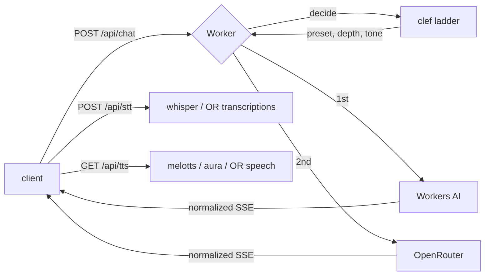

# ai-Ncards

A flip-card AI chat app, served entirely from one Cloudflare Worker: static
frontend plus `/api/*` on the same origin, so the client calls `/api/chat` and
there is no CORS or proxy URL to configure.

Inference is **Cloudflare-first**. Workers AI answers by default via a `clef`
decision model, and OpenRouter is the escalation rung for what Workers AI cannot
serve, plus the whole voice path's fallback. That can be turned off entirely —
see [Turning Cloudflare off](#turning-cloudflare-off).



## Endpoints

| Method | Path | Purpose |
|---|---|---|
| `GET` | `/api/health` | Which engines, bindings and features are live |
| `GET` | `/api/presets` | Preset ids and names only — no prompts, no model slugs |
| `POST` | `/api/chat` | `{ messages, preset, stream }` → normalized SSE |
| `POST` | `/api/stt` | WAV body, or `{ audio: "<base64>" }` → `{ text }` |
| `GET` | `/api/tts?t=&v=&m=` | Streamed mp3, cached immutably |
| `POST` | `/api/upload` | Bytes → R2 (needs `R2`) |
| `GET` | `/f/:id` | Serve an uploaded object from R2 |

### One wire format

The Worker normalizes three upstream dialects (Workers AI's `{"response":…}`,
OpenRouter's `choices[0].delta.content`, and each provider's error shape) into
four events. The client only knows these:

```
data: {"type":"meta","route":"workers-ai","model":"@cf/…","decision":{…}}
data: {"type":"delta","text":"…"}
data: {"type":"error","error":{"code":"…","message":"…"}}
data: [DONE]
```

Switching providers therefore needs no frontend change.

## Decision pipeline

`decide()` is an ordered chain, and every stage is optional: a missing binding
skips its stage instead of failing the request. Each `meta` event carries a
`trace` naming the stages that actually ran.

1. **cache** — `MEM` lookup keyed on the last user turn; a hit ends the chain
   before any model runs. This check is first, ahead of the decision itself.
   Hits come from a per-isolate memory layer in front of `MEM`, because a KV read
   can stay stale for up to 60s after the write that created it.
2. **intent** — clef starts the decision: the ladder (`clef-flash` → `clef-omni`
   → `clef`) classifies task, depth, tone and preset, escalating only when a
   window refuses.
3. **browse** — `AGENT-BROWSING` is consulted for `extract`/`compare` intents and
   for `deep` depth. A failed lookup is recorded as `browse:error` and ignored.
4. **user** — the intent is handed back and the answer is generated on…
5. **rung** — the preset the answer runs on: your pick, else the decision's, else
   `truth`.
6. **review** — the exchange is appended to `MASTER` with a 30-day TTL: preset,
   route, model, sizes, and the first 500/1500 characters of prompt and answer.

**No preset** is a fourth menu entry, not a preset. It sends the sentinel
`none`, so no preset prompt is applied and the OpenRouter rung calls the plain
model instead of `@preset/<slug>`. Clef still decides task, depth and model.

Otherwise a preset is always in effect, because the Cloudflare rung needs a
prompt. `truth` is the default and does not outrank the decision: clef's `task`
selects the model (`chat`/`generate` → gemma,
`transform`/`extract`/`compare` → qwen) and its `depth` sets the output budget.
A preset you pick deliberately outranks both.

## Presets

Each preset has two rungs: a Cloudflare model with a local prompt and sampling
params, and an OpenRouter preset slug. On the Workers AI rung the local
configuration applies. On the OpenRouter rung the request sends
`model: "@preset/<slug>"` and nothing else, because OpenRouter shallow-merges
request fields over preset fields — sending our temperature or system prompt
would override the preset and defeat the point of having one.

| Preset | Workers AI | OpenRouter preset |
|---|---|---|
| `truth` (default) | gemma-4-26b-a4b-it | `@preset/truth` |
| `operator` | qwen3.8-27b | `@preset/operator` |
| `mnl` | gemma-4-26b-a4b-it | `@preset/mnl` |

A bare slug is ignored by OpenRouter, so the `@preset/` prefix is required. Point
the slugs in `src/presets.js` at your own presets at
<https://openrouter.ai/settings/presets>; `/api/health` lists which ones are
preset-backed under `models.openrouterPresets`.

One asymmetry worth knowing: a preset's prompt lives in your OpenRouter account,
so the Workers AI rung cannot read it. If a preset has no system prompt set on
OpenRouter and the escalation rung answers, no preset prompt applies.

### Promoting presets from code

To stop the repo and the dashboard drifting, push the local table into the
account. Dry run is the default because applying overwrites the designated
version of any preset with the same slug:

```bash
npm run presets:sync -- --model google/gemini-2.5-flash            # print bodies
npm run presets:sync -- --model google/gemini-2.5-flash --apply    # write versions
```

`--model` is required until you set `or` on each preset, because guessing an
OpenRouter model would quietly repin a preset you tuned by hand. Two fields do
not survive the round trip: `max_tokens` is not part of preset config, so it
stays request-level, and on the preset rung we send none — the preset's own cap
applies.

## Bindings

The worker is `mind`. These are attached in the deployment:

| Binding | Type | Used for | Without it |
|---|---|---|---|
| `AI` | Workers AI | chat, STT, TTS, clef decisions | falls back to OpenRouter |
| `BUCKET` | R2 `r2-explorer-bucket` | `/api/upload`, `/f/:id`, TTS mp3 cache | uploads 503, TTS regenerates |
| `MEM` | KV `Memoria` | shared daily budget, decision cache, candidates and provisional truths | per-isolate memory, resets |
| `MASTER` | KV `master truths` | master truths, plus the review records of every exchange | falls back to `MEM` |
| `AGENT-BROWSING` | service `agent-browsing` | reserved — no route uses it | — |
| `ASSETS` | static assets | serves `public/` | no frontend |

Both namespaces are wired in `wrangler.jsonc` by id, so the daily budget and the
clef decision cache survive isolate restarts. `/api/health` answers
`features.sharedBudget: true` once they are attached; `false` means the worker
fell back to per-isolate memory and the budget will reset.

## Building and deploying

```sh
npm ci          # install exactly what the lockfile pins
npm test        # the whole suite, no network needed
npm run build   # wrangler deploy --dry-run; exits cleanly with no credentials
npm run ci      # test + build, the pair a pipeline needs to pass
npm run deploy  # the real deploy, needs a logged-in wrangler
```

A build that never finishes is almost always a command that does not exit:
`npm run dev` and `wrangler dev` watch forever by design, and `wrangler deploy`
stops to ask which account to use when it has no token. For Workers Builds, set
the build command to `npm ci` and the deploy command to `npx wrangler deploy`.
`.github/workflows/deploy.yml` does the same from GitHub, caps the job at ten
minutes, and takes its credentials from the `CLOUDFLARE_API_TOKEN` and
`CLOUDFLARE_ACCOUNT_ID` repository secrets.

## Truth layers

Every generated answer is written to `MEM` as a candidate with a `hits` count,
so nothing has to be retyped to promote it. The key is a blunt normalization of
the query — lower case, collapsed spacing, trailing punctuation removed — because
a fuzzy match would promote the wrong answer.

The console is `public/admin.html`, served at `/admin` (the assets layer
redirects `/admin.html` to it). It is gated by the
`ADMIN_KEY` secret: the page asks for the key, keeps it in `sessionStorage` for the
tab, and sends it as `x-admin-key` (or as a bearer token). With `ADMIN_KEY` unset
every console route answers `503 admin_key_unset`; a wrong key is `401
admin_key_required`. `mind` still exposes no route that writes a truth, so nothing
reachable through this app's API can change one.

```bash
npx wrangler secret put ADMIN_KEY   # once; then paste it into the console
```

| Route | What it does |
| --- | --- |
| `POST /api/admin/unlock` | checks the key, names the bound stores |
| `GET /api/admin/keys?store=MEM&limit=200&cursor=` | one page of keys: question, answer preview, length, kind, hits |
| `GET /api/admin/key?store=MEM&name=<key>` | the full value behind one row |

The page walks those pages until the store runs out and sorts in the browser by key
name, question, answer length, kind or newest — a store of a couple of thousand keys
is browsable and filterable instead of one key at a time. Clicking a row opens the
pair in the editor; master records are saved back to master, everything else through
the provisional route, exactly as this console has always worked. Promotion is a script
calling `promote()` in `src/truth.js`: `master` records go to the `MASTER`
namespace, `provisional` ones to `MEM`, and the id is the SHA-256 of the
normalized query. A master truth answers its query straight out of KV without
running clef or any model.

### Reading what is already stored

The first cache check is a read, and it is deliberately generous, because a pair
that is already stored is the truth even when this app did not write it. In order
it tries:

1. `truth:master:<sha256>`, `truth:provisional:<sha256>`, `candidate:<sha256>`
2. `<layer>:<id>`, `truth:<layer>:<query>`, `<layer>:<query>`, `truth:<id>`, `truth:<query>`
3. the key name itself — an opaque slug such as `ranger1189` is the query
4. a bounded scan (500 keys listed, 30 read) for a record whose `query` or `input`
   says it answers the question

Step 0 is the truth worker itself. Bound as a service — the account uses
`unsafe.bindings` with `{ "name": "TRUTH", "type": "service", "service":
"truth" }` — its `/api/truth/resolve` is called with `{ input }`, exactly as the
console calls it, and the canonical body comes back: `{ status, layer, id, answer,
meta.citations }`. A miss is a `200` with `status: "miss"` and `layer: "none"`,
and so is a failed or slow call (capped at 12s); both fall through to the local
layers below, so a truth worker that is down costs a lookup, never an answer.

That resolve is resolve-or-create: when neither layer holds the query it generates
a candidate and stores it as `provisional:<id>` before answering, so a question
this app has never seen can come back as a `provisional` layer. That is the store
filling itself with new pairs — and it is the only way this app adds to it, since
no write route is ever called from here. A curated master cannot be replaced.

Every bound KV store is searched as well: `MASTER`, then `MEM`. The answer may sit
under `answer`, `html`, `text`, `content`, `body`, `response`, or be the stored
value itself.

Writes never replace a stored pair. A different answer is kept beside the first as
an `alternatives[]` entry; `promote()` returns `{ saved: false, conflict: true }`
instead of overwriting unless called with `overwrite: true`; master records carry
no TTL, so a curated answer cannot quietly expire; and promoting a master no
longer deletes the provisional underneath it — master wins by precedence.

Clashes are reported to a separate Worker. Bind one as `ALERTS` (or set a
`TRUTH_ALERTS_URL` var) and it receives a JSON POST:

```json
{ "service": "mind", "type": "candidate_divergence", "query": "ranger1189",
  "id": "<sha256>", "key": "candidate:<sha256>", "layer": "candidate",
  "existing": "the stored answer", "incoming": "the new one", "at": "<iso>" }
```

`type` is `candidate_divergence` or `promote_conflict`. Unbound means no notice:
a chat never fails over one.

Only the escalation rung needs a secret:

```bash
npx wrangler secret put OPENROUTER_API_KEY
```

`MASTER` holds the promoted truths the first cache check reads. `AGENT-BROWSING`
is bound to match the account and is a browsing tool this app does not use. The
Worker reaches OpenRouter directly with `OPENROUTER_API_KEY`.

Configuration lives in `wrangler.jsonc` **only**. With both a `wrangler.toml` and
a `wrangler.jsonc` in the repo, wrangler 4.157 silently uses the `.jsonc` and
ignores the `.toml` — no warning — so any `wrangler.toml` here is dead config.

## Why the voice path looks like this

`MediaRecorder` produces `webm/opus` in Chrome and `mp4/aac` in Safari, and
**neither can be byte-sliced** — cut one mid-frame and the transcript is garbage.
So the browser decodes the recording and re-encodes it to 16 kHz mono WAV, where
every slice can carry its own header. That also matters because the Responses API
accepts only `wav` or `mp3` for `input_audio`, never `webm`.

Whisper runs in 30-second chunks (~1 MB), each seeded with the tail of the
previous transcript via `initial_prompt` — that is what keeps punctuation from
collapsing at every boundary.

TTS is a **cacheable GET** rather than a POST so an `<audio>` element can stream
it and Cloudflare's edge can hold the result. Repeat reads cost zero neurons.

## Turning Cloudflare off

Neurons are a daily allowance; OpenRouter is not. Settings → **Engine** has a
switch that flips the whole Worker to OpenRouter-only. It is server state, not a
browser preference: the value is written to MEM as `settings:engine`, so every
isolate and every device follows the same switch.

Reading the switch is public — the page needs the label — but writing it needs the
`KEY` secret, sent as `x-engine-key` or `Authorization: Bearer`. Without `KEY` set
the write fails closed with `503 key_unset` rather than leaving the switch open.

```bash
npx wrangler secret put KEY          # once; use that value below
curl -s https://mind.ai-n.workers.dev/api/engine
curl -s -X POST https://mind.ai-n.workers.dev/api/engine \
  -H "x-engine-key: $KEY" -H 'content-type: application/json' \
  -d '{"cloudflare":false}'
```

With it off, no `env.AI.run` is called at all:

- chat answers from OpenRouter's free router, `openrouter/free`, which picks a free
  model per request; set `OPENROUTER_FREE_MODEL` to pin a specific `:free` slug
  instead. Presets are skipped on this path — their prompts and models live in the
  account and are paid — so the preset's local system prompt and sampling params
  travel with the request
- clef is skipped, so the decision falls back to the preset (`intent:fallback` in
  `decision.trace`) and costs nothing
- STT and TTS move to OpenRouter's transcriptions and speech endpoints
- nothing is charged against `DAILY_NEURONS`, so the allowance stops draining
- curated truths still answer first: that cache is KV and a service binding, not
  a model

It refuses to switch off when `OPENROUTER_API_KEY` is unset (`409
no_openrouter_key`) rather than leaving the app with no engine at all, and it
refuses a write without the key (`401 key_required`). KV is only eventually
consistent, so an isolate holding the old value can take up to ten seconds to
notice a flip.

## Cost

Neurons per IP per UTC day are shared across chat, STT and TTS (`DAILY_NEURONS`,
default 8000 of the 10000 free allowance). Roughly:

| Work | Rate | 10k neurons buys |
|---|---|---|
| Whisper large-v3-turbo | 46.63 / audio min | ~3.6 h of audio |
| melotts | 18.63 / audio min | ~8.9 h of speech |
| aura-2-en | 2,727 / 1k chars | ~3,700 characters |
| gemma-4-26b-a4b-it | 9,091 / M input tokens | ~1.1 M input tokens |

melotts is ~130× cheaper than aura for the same text, which is why it is the
default and aura is a per-card choice.

## Development

```bash
npm install
cp .dev.vars.example .dev.vars   # add OPENROUTER_API_KEY if you want the fallback
npm test                          # 24 tests, no network, no credentials
npm run dev                       # http://localhost:8787
npm run dry-run                   # bundle check without deploying
npm run deploy
```

Tests stub `env.AI` and `fetch`, so the whole ladder — decision escalation,
provider fallback, budget exhaustion, WAV chunking, graceful degradation — is
verifiable offline.

## Layout

```
src/index.js              router, chat/stt/tts/upload, provider ladder
src/decide.js             clef decision ladder + KV cache + fallback
src/providers/workers-ai.js   chat, whisper, melotts/aura
src/providers/openrouter.js   chat, transcriptions, speech
src/audio.js              WAV parse, wrap, sample-aligned chunking
src/budget.js             shared daily neuron budget
src/normalize.js          SSE wire format and per-vendor extractors
src/presets.js            server-side preset table
src/preset-sync.js        promote presets into the OpenRouter account
src/bindings.js           resolve MEM / BUCKET by their deployed names
scripts/sync-presets.mjs  presets:sync CLI, dry run by default
public/                   index.html, script.js, style.css
test.mjs                  offline test suite
```

The stray `2.html`, `3.html` and `4.html` prototypes are gone; the app is
`public/index.html` and nothing was serving those files.

## Status

Working: chat with decision routing and provider fallback, ASR, TTS, presets,
health. Pending: attaching voice notes and images to cards (`/api/stt` and
`/api/upload` exist; the card UI does not use them yet), and PDF/audio/video
input to the model.

## Licence

Apache-2.0 — see [LICENSE](LICENSE).

## Screenshots (`/api/shot`)

```
GET /api/shot?url=https://example.com          # JPEG of the viewport
GET /api/shot?url=https://example.com&full=1   # JPEG of the whole page
```

Renders the page headless through Cloudflare Browser Rendering and returns the
bytes. One request launches one browser, navigates once with a 20 second limit,
shoots, and closes in a `finally` — a failed navigation cannot leave a session
billing in the background. The answer is JPEG at quality 80, not PNG, on purpose.

The binding is `MYBROWSER` in `wrangler.jsonc`:

```jsonc
"browser": { "binding": "MYBROWSER" }
```

Browser Rendering must be enabled on the account, and it is billed per
browser-second. Without the binding the route answers `501 browser_unbound`
and `/api/health` reports `features.screenshots: false`. It is currently
unauthenticated: `?url=` is validated as http(s) and nothing else, but anyone
who finds the route can spend browser seconds, so put it behind `ADMIN_KEY`
before pointing a busy page at it.

## Pages on cards

A card can carry the page it is about. Only the URL is stored; the image is drawn
from `/api/shot` when the card renders, so a board of twenty pages does not add
twenty megabytes to localStorage.

- Name a link in a prompt — `summarise https://example.com/report` — and the card
  it produces shows that page's screenshot, linked to the page.
- Or use the card menu: **Screenshot Page** attaches or replaces the page on a
  card that already exists.
- Tapping the thumbnail opens the page instead of flipping the card.
- Shots are cached in R2 for ten minutes (`x-screenshot-cache: hit | miss`), which
  is what stops a grid of cards launching a browser on every render.
