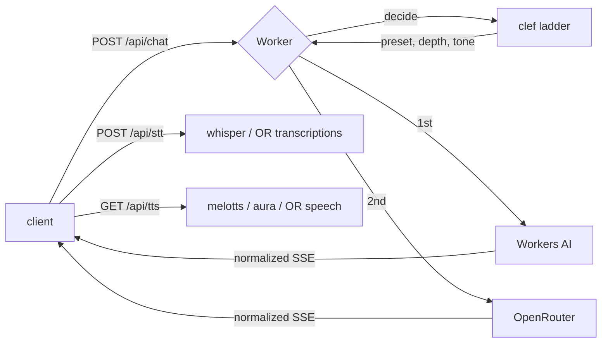

# ai-Ncards

A flip-card AI chat app, served entirely from one Cloudflare Worker: static
frontend plus `/api/*` on the same origin, so the client calls `/api/chat` and
there is no CORS or proxy URL to configure.

Inference is **Cloudflare-first**. Workers AI answers by default via a `clef`
decision model, and OpenRouter is the escalation rung for what Workers AI cannot
serve, plus the whole voice path's fallback.



## Endpoints

| Method | Path | Purpose |
|---|---|---|
| `GET` | `/api/health` | Which engines, bindings and features are live |
| `GET` | `/api/presets` | Preset ids and names only — no prompts, no model slugs |
| `POST` | `/api/chat` | `{ messages, preset, stream }` → normalized SSE |
| `POST` | `/api/stt` | WAV body, or `{ audio: "<base64>" }` → `{ text }` |
| `GET` | `/api/tts?t=&v=&m=` | Streamed mp3, cached immutably |
| `POST` | `/api/upload` | Bytes → R2 (needs `R2`) |
| `GET` | `/f/:id` | Serve an uploaded object from R2 |

### One wire format

The Worker normalizes three upstream dialects (Workers AI's `{"response":…}`,
OpenRouter's `choices[0].delta.content`, and each provider's error shape) into
four events. The client only knows these:

```
data: {"type":"meta","route":"workers-ai","model":"@cf/…","decision":{…}}
data: {"type":"delta","text":"…"}
data: {"type":"error","error":{"code":"…","message":"…"}}
data: [DONE]
```

Switching providers therefore needs no frontend change.

## Decision pipeline

`decide()` is an ordered chain, and every stage is optional: a missing binding
skips its stage instead of failing the request. Each `meta` event carries a
`trace` naming the stages that actually ran.

1. **cache** — `MEM` lookup keyed on the last user turn; a hit ends the chain.
2. **intent** — the clef ladder (`clef-flash` → `clef-omni` → `clef`) classifies
   task, depth, tone and preset, escalating only when a window refuses.
3. **browse** — `AGENT-BROWSING` is consulted for `extract`/`compare` intents and
   for `deep` depth. A failed lookup is recorded as `browse:error` and ignored.
4. **user** — the intent is handed back and the answer is generated on…
5. **rung** — the preset the answer runs on: your pick, else the decision's, else
   `truth`.
6. **review** — the exchange is appended to `MASTER` with a 30-day TTL: preset,
   route, model, sizes, and the first 500/1500 characters of prompt and answer.

There is no preset-less mode: the client always sends one, and `truth` is the
default because the Cloudflare rung needs a prompt either way. That default does
not outrank the decision — clef's `task` selects the Cloudflare model
(`chat`/`generate` → gemma, `transform`/`extract`/`compare` → qwen), its `depth`
sets the output budget, and its `preset` can steer past `truth`. A preset chosen
deliberately outranks all three.

## Presets

Each preset has two rungs: a Cloudflare model with a local prompt and sampling
params, and an OpenRouter preset slug. On the Workers AI rung the local
configuration applies. On the OpenRouter rung the request sends
`model: "@preset/<slug>"` and nothing else, because OpenRouter shallow-merges
request fields over preset fields — sending our temperature or system prompt
would override the preset and defeat the point of having one.

| Preset | Workers AI | OpenRouter preset |
|---|---|---|
| `truth` (default) | gemma-4-26b-a4b-it | `@preset/truth` |
| `operator` | qwen3.8-27b | `@preset/operator` |
| `mnl` | gemma-4-26b-a4b-it | `@preset/mnl` |

A bare slug is ignored by OpenRouter, so the `@preset/` prefix is required. Point
the slugs in `src/presets.js` at your own presets at
<https://openrouter.ai/settings/presets>; `/api/health` lists which ones are
preset-backed under `models.openrouterPresets`.

One asymmetry worth knowing: a preset's prompt lives in your OpenRouter account,
so the Workers AI rung cannot read it. If a preset has no system prompt set on
OpenRouter and the escalation rung answers, no preset prompt applies.

### Promoting presets from code

To stop the repo and the dashboard drifting, push the local table into the
account. Dry run is the default because applying overwrites the designated
version of any preset with the same slug:

```bash
npm run presets:sync -- --model google/gemini-2.5-flash            # print bodies
npm run presets:sync -- --model google/gemini-2.5-flash --apply    # write versions
```

`--model` is required until you set `or` on each preset, because guessing an
OpenRouter model would quietly repin a preset you tuned by hand. Two fields do
not survive the round trip: `max_tokens` is not part of preset config, so it
stays request-level, and on the preset rung we send none — the preset's own cap
applies.

## Bindings

The worker is `mind`. These are attached in the deployment:

| Binding | Type | Used for | Without it |
|---|---|---|---|
| `AI` | Workers AI | chat, STT, TTS, clef decisions | falls back to OpenRouter |
| `BUCKET` | R2 `r2-explorer-bucket` | `/api/upload`, `/f/:id`, TTS mp3 cache | uploads 503, TTS regenerates |
| `MEM` | KV `Memoria` | shared daily budget, decision cache | per-isolate memory, resets |
| `MASTER` | KV `master truths` | reserved — nothing reads it yet | — |
| `AGENT-BROWSING` | service `agent-browsing` | reserved — no route uses it | — |
| `ASSETS` | static assets | serves `public/` | no frontend |

Both namespaces are wired in `wrangler.jsonc` by id, so the daily budget and the
clef decision cache survive isolate restarts. `/api/health` answers
`features.sharedBudget: true` once they are attached; `false` means the worker
fell back to per-isolate memory and the budget will reset.

Only the escalation rung needs a secret:

```bash
npx wrangler secret put OPENROUTER_API_KEY
```

`MASTER` and `AGENT-BROWSING` are bound to match the account but are not called:
no route reads the `master truths` namespace yet, and `AGENT-BROWSING` is a
browsing tool this app does not use. The Worker reaches OpenRouter directly with
`OPENROUTER_API_KEY`.

Configuration lives in `wrangler.jsonc` **only**. With both a `wrangler.toml` and
a `wrangler.jsonc` in the repo, wrangler 4.157 silently uses the `.jsonc` and
ignores the `.toml` — no warning — so any `wrangler.toml` here is dead config.

## Why the voice path looks like this

`MediaRecorder` produces `webm/opus` in Chrome and `mp4/aac` in Safari, and
**neither can be byte-sliced** — cut one mid-frame and the transcript is garbage.
So the browser decodes the recording and re-encodes it to 16 kHz mono WAV, where
every slice can carry its own header. That also matters because the Responses API
accepts only `wav` or `mp3` for `input_audio`, never `webm`.

Whisper runs in 30-second chunks (~1 MB), each seeded with the tail of the
previous transcript via `initial_prompt` — that is what keeps punctuation from
collapsing at every boundary.

TTS is a **cacheable GET** rather than a POST so an `<audio>` element can stream
it and Cloudflare's edge can hold the result. Repeat reads cost zero neurons.

## Cost

Neurons per IP per UTC day are shared across chat, STT and TTS (`DAILY_NEURONS`,
default 8000 of the 10000 free allowance). Roughly:

| Work | Rate | 10k neurons buys |
|---|---|---|
| Whisper large-v3-turbo | 46.63 / audio min | ~3.6 h of audio |
| melotts | 18.63 / audio min | ~8.9 h of speech |
| aura-2-en | 2,727 / 1k chars | ~3,700 characters |
| gemma-4-26b-a4b-it | 9,091 / M input tokens | ~1.1 M input tokens |

melotts is ~130× cheaper than aura for the same text, which is why it is the
default and aura is a per-card choice.

## Development

```bash
npm install
cp .dev.vars.example .dev.vars   # add OPENROUTER_API_KEY if you want the fallback
npm test                          # 24 tests, no network, no credentials
npm run dev                       # http://localhost:8787
npm run dry-run                   # bundle check without deploying
npm run deploy
```

Tests stub `env.AI` and `fetch`, so the whole ladder — decision escalation,
provider fallback, budget exhaustion, WAV chunking, graceful degradation — is
verifiable offline.

## Layout

```
src/index.js              router, chat/stt/tts/upload, provider ladder
src/decide.js             clef decision ladder + KV cache + fallback
src/providers/workers-ai.js   chat, whisper, melotts/aura
src/providers/openrouter.js   chat, transcriptions, speech
src/audio.js              WAV parse, wrap, sample-aligned chunking
src/budget.js             shared daily neuron budget
src/normalize.js          SSE wire format and per-vendor extractors
src/presets.js            server-side preset table
src/preset-sync.js        promote presets into the OpenRouter account
src/bindings.js           resolve MEM / BUCKET by their deployed names
scripts/sync-presets.mjs  presets:sync CLI, dry run by default
public/                   index.html, script.js, style.css
test.mjs                  offline test suite
```

`2.html`, `3.html` and `4.html` are earlier prototypes kept for reference; they
are outside `public/` and are not served.

## Status

Working: chat with decision routing and provider fallback, ASR, TTS, presets,
health. Pending: attaching voice notes and images to cards (`/api/stt` and
`/api/upload` exist; the card UI does not use them yet), and PDF/audio/video
input to the model.

## Licence

Apache-2.0 — see [LICENSE](LICENSE).
