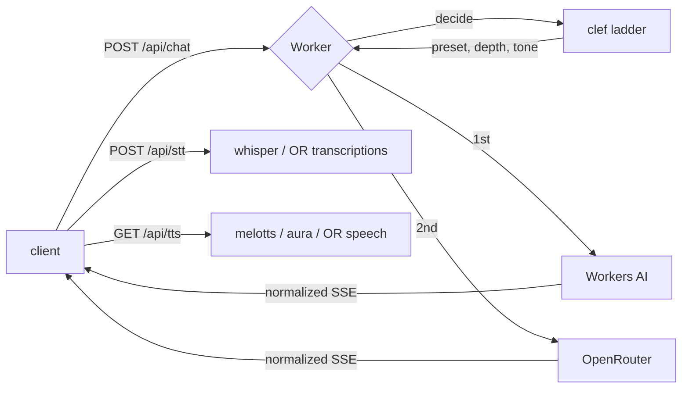

# ai-Ncards

A flip-card AI chat app, served entirely from one Cloudflare Worker: static
frontend plus `/api/*` on the same origin, so the client calls `/api/chat` and
there is no CORS or proxy URL to configure.

Inference is **Cloudflare-first**. Workers AI answers by default via a `clef`
decision model, and OpenRouter is the escalation rung for what Workers AI cannot
serve, plus the whole voice path's fallback.



## Endpoints

| Method | Path | Purpose |
|---|---|---|
| `GET` | `/api/health` | Which engines, bindings and features are live |
| `GET` | `/api/presets` | Preset ids and names only — no prompts, no model slugs |
| `POST` | `/api/chat` | `{ messages, preset, stream }` → normalized SSE |
| `POST` | `/api/stt` | WAV body, or `{ audio: "<base64>" }` → `{ text }` |
| `GET` | `/api/tts?t=&v=&m=` | Streamed mp3, cached immutably |
| `POST` | `/api/upload` | Bytes → R2 (needs `R2`) |
| `GET` | `/f/:id` | Serve an uploaded object from R2 |

### One wire format

The Worker normalizes three upstream dialects (Workers AI's `{"response":…}`,
OpenRouter's `choices[0].delta.content`, and each provider's error shape) into
four events. The client only knows these:

```
data: {"type":"meta","route":"workers-ai","model":"@cf/…","decision":{…}}
data: {"type":"delta","text":"…"}
data: {"type":"error","error":{"code":"…","message":"…"}}
data: [DONE]
```

Switching providers therefore needs no frontend change.

## Bindings

`AI` is bound already and needs no key or id. The rest are optional: the Worker
runs without them and reports what is missing at `/api/health`.

| Binding | Needed for | Without it |
|---|---|---|
| `AI` | chat, STT, TTS, decisions | falls back to OpenRouter |
| `OPENROUTER_API_KEY` (secret) | escalation, PDF/AV input | chat stays on Workers AI |
| `KV` | shared daily neuron budget, decision cache | per-isolate memory, resets |
| `R2` | uploads, TTS mp3 cache | uploads 503, TTS regenerates |

To add the two optional ones, uncomment the blocks in `wrangler.jsonc` after
creating them:

```bash
npx wrangler kv namespace create KV
npx wrangler r2 bucket create ai-ncards
npx wrangler secret put OPENROUTER_API_KEY
```

## Why the voice path looks like this

`MediaRecorder` produces `webm/opus` in Chrome and `mp4/aac` in Safari, and
**neither can be byte-sliced** — cut one mid-frame and the transcript is garbage.
So the browser decodes the recording and re-encodes it to 16 kHz mono WAV, where
every slice can carry its own header. That also matters because the Responses API
accepts only `wav` or `mp3` for `input_audio`, never `webm`.

Whisper runs in 30-second chunks (~1 MB), each seeded with the tail of the
previous transcript via `initial_prompt` — that is what keeps punctuation from
collapsing at every boundary.

TTS is a **cacheable GET** rather than a POST so an `<audio>` element can stream
it and Cloudflare's edge can hold the result. Repeat reads cost zero neurons.

## Cost

Neurons per IP per UTC day are shared across chat, STT and TTS (`DAILY_NEURONS`,
default 8000 of the 10000 free allowance). Roughly:

| Work | Rate | 10k neurons buys |
|---|---|---|
| Whisper large-v3-turbo | 46.63 / audio min | ~3.6 h of audio |
| melotts | 18.63 / audio min | ~8.9 h of speech |
| aura-2-en | 2,727 / 1k chars | ~3,700 characters |
| gemma-4-26b-a4b-it | 9,091 / M input tokens | ~1.1 M input tokens |

melotts is ~130× cheaper than aura for the same text, which is why it is the
default and aura is a per-card choice.

## Development

```bash
npm install
cp .dev.vars.example .dev.vars   # add OPENROUTER_API_KEY if you want the fallback
npm test                          # 17 tests, no network, no credentials
npm run dev                       # http://localhost:8787
npm run dry-run                   # bundle check without deploying
npm run deploy
```

Tests stub `env.AI` and `fetch`, so the whole ladder — decision escalation,
provider fallback, budget exhaustion, WAV chunking, graceful degradation — is
verifiable offline.

## Layout

```
src/index.js              router, chat/stt/tts/upload, provider ladder
src/decide.js             clef decision ladder + KV cache + fallback
src/providers/workers-ai.js   chat, whisper, melotts/aura
src/providers/openrouter.js   chat, transcriptions, speech
src/audio.js              WAV parse, wrap, sample-aligned chunking
src/budget.js             shared daily neuron budget
src/normalize.js          SSE wire format and per-vendor extractors
src/presets.js            server-side preset table
public/                   index.html, script.js, style.css
test.mjs                  offline test suite
```

`2.html`, `3.html` and `4.html` are earlier prototypes kept for reference; they
are outside `public/` and are not served.

## Status

Working: chat with decision routing and provider fallback, ASR, TTS, presets,
health. Pending: attaching voice notes and images to cards (`/api/stt` and
`/api/upload` exist; the card UI does not use them yet), and PDF/audio/video
input to the model.

## Licence

Apache-2.0 — see [LICENSE](LICENSE).
